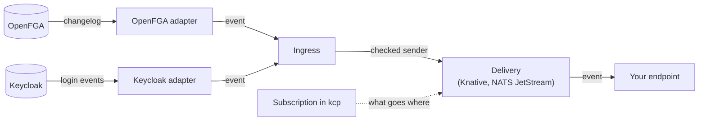

# Platform Mesh Eventing

Eventing lets other systems react to what happens in Platform Mesh without polling it.

Today, when someone is added to an account, a user logs in, or a provider changes a resource, nothing tells anyone else. Every system that cares has to poll OpenFGA, Keycloak or kcp itself, map the data on its own, and handle retries. This repository adds an optional module that turns those changes into [CloudEvents](https://cloudevents.io) and delivers them to subscribers.

## How it works



OpenFGA can't send events, so the adapter reads its changelog and turns a change like "Alice became member of team-a" into an event. A platform admin creates a Subscription in the eventing workspace in kcp (which events, which URL), and delivery sends matching events there, with retries. There is one stream for the whole platform; every event names the org it belongs to.

A second adapter reads Keycloak's event store and sends an event after every login. Later more systems get adapters (kcp), and providers will be able to send their own events too.

More detail: [architecture](docs/architecture.md), [event contract](docs/contract.md), [receiving events](docs/subscribing.md), [decisions](docs/adr/).

## What it does not do

- It does not change any existing Platform Mesh component. Eventing observes the system from outside and can be installed or removed independently.
- It does not connect to message brokers on the subscriber side. A subscriber that needs GCP Pub/Sub, Kafka or similar runs its own bridge behind an HTTP endpoint.

## What it covers today

- Membership events (a user gets or loses a role on an account) and a snapshot
  of an account's members after each change, read from OpenFGA. Events carry the
  account's workspace path. The snapshot has the members' first and last names
  where Keycloak knows them.
- A login event after every login to an org's Keycloak realm.
- Subscriptions for platform admins, covering all orgs or some of them, with
  retries, timeouts and dead letter sinks. Sinks must be on the platform
  operator's allowlist.
- Events are stored in NATS JetStream before delivery, so restarts lose nothing.

What comes after is in the [roadmap](docs/roadmap.md).

## Install

Eventing is installed through a `ManagedProvider`: the platform-mesh-operator
creates eventing's workspace in kcp, `root:providers:eventing-<id>`, and
installs the chart with Flux into `platform-mesh-system`. Platform Mesh's
prerequisites chart brings Flux and the ocm-controller.

Coming from the old install (namespace `contrib-eventing`, workspace
`root:providers:eventing`, `contrib-eventing-*` NetworkPolicies)? Run its
`hack/uninstall.sh` first. The adapters' state is not carried over.

1. **Knative Eventing and NATS JetStream.** Knative in that cluster must be
   used by eventing only (see
   [architecture](docs/architecture.md#how-it-plugs-in)), and the CNI must
   enforce NetworkPolicies. `hack/steps/10-knative.sh` sets up all of this:
   - Knative Eventing (v1.23) with the channel based broker and its NATS
     JetStream channel.
   - NATS with JetStream on a volume. NATS has no auth, so lock it down like
     the NetworkPolicy in [`config/nats/nats.yaml`](config/nats/nats.yaml):
     only the JetStream channel's controller and dispatcher (pods with
     `messaging.knative.dev/channel: nats-jetstream-channel` in
     `knative-eventing`) may connect. Otherwise any pod can write events into
     the stream past eventing's ingress.
   - [`config-nats`](config/nats/config-nats.yaml), which tells the channel
     where NATS is.
   - [`config-br-default-channel`](config/nats/config-br-default-channel.yaml),
     which makes the JetStream channel the default for new Brokers.

   The chart refuses to install without Knative and the JetStream default
   channel. It does not check NATS.
2. **The core connection.** Add the entry in
   [`config/install/core-connection.yaml`](config/install/core-connection.yaml)
   to the `PlatformMesh`'s `spec.kcp.extraProviderConnections`. The OpenFGA
   adapter reads account paths with it. The entry is read-only; drop
   `readOnly` on a platform-mesh-operator from before
   [platform-mesh#591](https://github.com/platform-mesh/platform-mesh/pull/591).
3. **Keycloak access** (optional), for login events and names:
   security-operator with
   `--idp-events-reader-client=contrib-eventing-keycloak-reader`
   ([platform-mesh/platform-mesh#606](https://github.com/platform-mesh/platform-mesh/pull/606)),
   and the client's credentials in the Secret `contrib-eventing-keycloak-reader`
   (keys `client_id`, `client_secret`) in `platform-mesh-system`. Then set
   `keycloak.readerSecret: contrib-eventing-keycloak-reader`; the chart refuses
   to install if that Secret is missing. Without it there are no login events
   and no names.
4. **The ManagedProvider.** Apply
   [`config/install/managedprovider.yaml`](config/install/managedprovider.yaml),
   which installs the OCM component, with your base domain, the hosts sinks
   may point at and the user claim. All values are in
   [`charts/eventing/values.yaml`](charts/eventing/values.yaml). Without OCM,
   [`managedprovider-flux.yaml`](config/install/managedprovider-flux.yaml)
   installs the chart straight from its OCI registry.

Subscriptions go into eventing's workspace, which a platform admin finds in
`root:providers`:

```sh
kubectl get workspaces   # in root:providers: eventing-<id>
```

How to subscribe is in
[receiving events](docs/subscribing.md), what delivery guarantees in
[architecture](docs/architecture.md#delivery-guarantees).

### Removing eventing

Deleting the `ManagedProvider` uninstalls the chart, but not everything goes
with it. The controller creates the Broker `default` in `platform-mesh-system`
and a Trigger per Subscription itself, so they stay, and so do the workspace
and the Subscriptions unless `cleanupOnDelete` is true. The chart keeps its
NetworkPolicies in `knative-eventing` on uninstall, because without them any
pod could send events straight to the Broker and every remaining subscriber
would get them. To remove eventing completely, in this order:

1. Delete the Subscriptions in eventing's workspace. The controller removes
   their Triggers. With `cleanupOnDelete: true` this has to come first,
   otherwise the Subscriptions' finalizer blocks the workspace deletion.
2. Delete the `ManagedProvider`.
3. Delete the Broker and wait until it is gone:
   `kubectl -n platform-mesh-system delete broker default`.
4. Only then delete the NetworkPolicies:
   `kubectl -n knative-eventing delete networkpolicy -l app.kubernetes.io/name=eventing,app.kubernetes.io/instance=eventing`.
5. What else is left: the adapters' state ConfigMaps
   (`eventing-*-adapter-state`) and the core connection.

`hack/uninstall.sh` does it in that order.

## Try it locally

You need a local Platform Mesh on kind, installed as described in
[helm-charts/installation](https://github.com/platform-mesh/helm-charts/tree/main/installation),
and `kubectl`, `helm`, `docker`, `curl` and `jq`. The install adds Knative
Eventing and a single NATS JetStream server, builds the image into kind, builds
the OCM component with `hack/ocm-component.sh` into a registry container
`kind-registry` and applies the `ManagedProvider` with `ocm:`. The kind node
can't pull from that registry, so the `ManagedProvider` sets the `image` values
to the image loaded into kind.

```sh
./hack/install.sh     # adds eventing, a subscribed sink and a demo org eventing-demo
./hack/add-member.sh  # gives a user the member role on the demo org
kubectl -n eventing-demo-sink logs deploy/event-display
```

Unless security-operator manages the Keycloak reader client, the install also
sets up read-only access to Keycloak, as a stopgap until Platform Mesh provides
it ([platform-mesh/platform-mesh#578](https://github.com/platform-mesh/platform-mesh/issues/578)):
a client in the `master` realm with only `view-events` and `view-users` on the org realms, and the
event store of the org realms switched on for logins, with 7 days of retention
(`KEYCLOAK_EVENTS_RETENTION`, in seconds). `hack/uninstall.sh` undoes exactly that. Orgs created
after the install are not covered until #578 lands; running `./hack/install.sh` again covers them.
The demo user can log in with `./hack/login.sh`, which makes the sink show a `user.loggedin` event.

The sink shows a `membership.granted` event. `./hack/add-member.sh --remove`
takes the role away again, `./test/e2e.sh` checks the whole path,
`./test/install-check.sh --uninstall` checks that installing again changes
nothing and uninstalling leaves nothing, and `./hack/uninstall.sh` removes
everything. CI runs the same on a released Platform Mesh
(`test/platform-mesh.sh`).

## Releases

A `v<version>` tag publishes the image `ghcr.io/platform-mesh/contrib-eventing`,
the chart `oci://ghcr.io/platform-mesh/contrib-eventing/charts/eventing` and
the OCM component `github.com/platform-mesh/contrib-eventing` in
`ghcr.io/platform-mesh`, all with the version without the `v`.

## Background

- Epic: [platform-mesh/backlog#323](https://github.com/platform-mesh/backlog/issues/323)
- Spike and results: [platform-mesh/backlog#421](https://github.com/platform-mesh/backlog/issues/421)
- Modularization: [RFC 008](https://github.com/platform-mesh/architecture/blob/main/rfc/008-platform-mesh-modularization.md)
