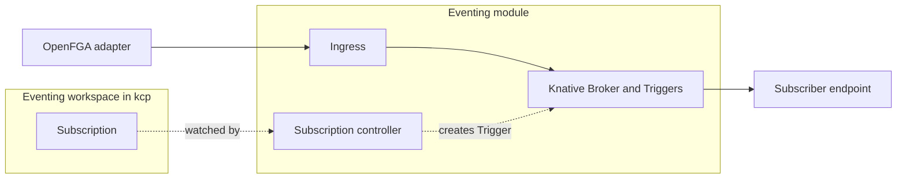

# Architecture

This page explains the parts of the eventing module and how an event travels through them. The reasons behind the choices are in the [decision records](adr/).

## The parts

| Part | What it does | Who builds it |
| --- | --- | --- |
| OpenFGA adapter | Reads the OpenFGA changelog and turns membership changes into events | us |
| Ingress | Checks who is sending, then hands the event to the broker. Reachable through the platform's Gateway | us |
| Subscription API | A kcp resource for platform admins in `root:providers:eventing`: event types, optional orgs, target URL, retry settings | us |
| Subscription controller | Turns each Subscription into a Knative Trigger and reports status back | us |
| Delivery | Fan-out, filtering by type, retries, dead letters | Knative Eventing |

## An event, step by step

Example: Alice is made a member of account `team-a` in org `acme`.

1. Someone adds Alice in the portal, and iam-service writes a role tuple to OpenFGA. Nothing in that path knows about eventing.
2. The OpenFGA adapter polls the changelog of the `acme` store, sees the new tuple, and builds a `membership.granted` event ([contract](contract.md)).
3. The adapter posts the event to the ingress. The ingress checks the adapter's identity and forwards the event to the broker.
4. A Subscription asked for membership events (of all orgs, or of `acme`). Its Trigger matches, and Knative sends the event to the subscriber's URL.
5. If the subscriber does not answer with success, Knative retries with backoff. After the last attempt the event goes to a dead letter sink, if one is set.

## Tenancy

Subscriptions are for platform admins. They live in the provider workspace `root:providers:eventing`, which binds its own export. The export has no `APIExportPolicy`, so orgs cannot bind it.

One broker carries the events of all orgs. Every event names its org in `pmorg`, and a Subscription can be limited to some orgs.

Org-level and account-level subscriptions are not in the first milestone.

## How it plugs in

The module does not change Platform Mesh components. It needs:

- an APIExport for the Subscription API, bound in its own workspace;
- read access to the OpenFGA changelog;
- Knative Eventing in the cluster, used by eventing only. A NetworkPolicy lets only our ingress reach Knative's broker ingress, and that ingress is shared by every broker in the cluster;
- an HTTPRoute on the platform's Gateway, so publishers outside the cluster can reach the ingress.

If eventing is not installed, Platform Mesh works exactly as before.

## Delivery guarantees

- At least once: a subscriber can get the same event more than once and should ignore duplicates by event `id`.
- No ordering across events. In particular a role change arrives as two events (revoked and granted) in any order.
- The broker channel accepts an event before it delivers it, so a subscriber that keeps failing only delays itself.
- The in-memory channel used for development loses events on restart, including events not yet delivered. Production needs a durable broker class such as Kafka.

## Known gaps

These came out of the [spike](https://github.com/platform-mesh/backlog/issues/421) and are open work:

- The Knative broker ingress accepts any event from inside the cluster, which is why our own ingress sits in front of it. A NetworkPolicy lets only our ingress (and Knative itself) reach the broker ingress.
- The ingress accepts only the platform's own adapters so far. Providers publishing events for their orgs is not built yet.
- Subscriptions accept any URL. Targets should be limited by an allowlist that the platform operator controls.
- A subscriber that answers with a CloudEvent injects it into the stream: Knative treats the answer as a reply and sends it back to the broker, past our ingress. Accepted for milestone 1, to be fixed before a first consumer. Dropping the `knative-eventing` rule from the NetworkPolicy blocks replies; Knative OIDC with an EventPolicy would reject them properly.
- The ingress is reachable at `eventing.services.<domain>` through the `terminate-services` listener of the platform Gateway. In the kind setup the platform certificate covers `*.<domain>` but not `*.services.<domain>`, so that host gets Traefik's default certificate.
