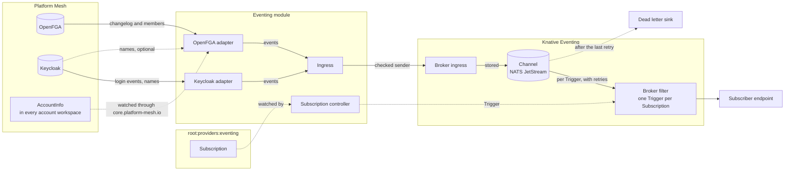
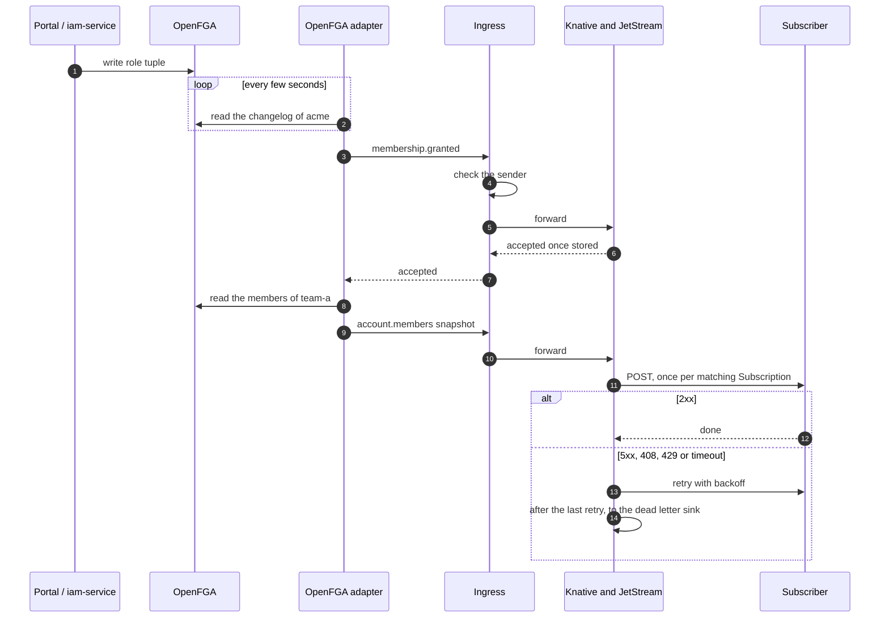

# Architecture

This page explains the parts of the eventing module and how an event travels through them. The reasons behind the choices are in the [decision records](adr/).

## TL;DR

Eventing tells other systems when something changes in the platform, so they don't have to poll for it.

- **Sources.** An adapter watches a system of record and turns each change into an event. Today that is who is a member of which account (OpenFGA changelog) and who logged in (Keycloak event store). After a membership change it also sends the full member list of the account, with names from Keycloak where it has access, so a consumer can catch up even if it missed events.
- **Events.** Every event has the same shape: a type, an id, the org it belongs to, and the data (CloudEvents over HTTP, see the [contract](contract.md)).
- **Ingress.** All events enter through one front door. It checks who is sending before it accepts anything (Kubernetes token review, behind the platform's Gateway).
- **Broker.** The broker stores each event before it says "accepted", so a restart loses nothing (Knative Eventing with a NATS JetStream channel). It keeps events for a day.
- **Subscriptions.** A platform admin declares which event types go to which URL, optionally limited to some orgs (a kcp API). A controller turns each one into a delivery rule in the broker (a Knative Trigger).
- **Delivery.** The broker sends every event to each matching subscriber with an HTTP POST. If the subscriber fails, it retries with growing pauses, then hands the event to a dead letter address if one is set.
- **Guarantees.** An event arrives at least once and in no particular order. Subscribers should ignore duplicates by event id.
- **Safety.** Subscribers can only be on hosts the platform operator allows. Their replies are blocked. Network rules keep anyone from skipping the front door (Kubernetes NetworkPolicies).
- **Optional.** Eventing is a separate module. It changes nothing in the rest of the platform, which works the same without it.

## The parts

Only the solid arrows carry events, and NetworkPolicies let each part of
Knative be reached only from the part before it (see
[how it plugs in](#how-it-plugs-in)).

| Part | What it does | Who builds it |
| --- | --- | --- |
| OpenFGA adapter | Reads the OpenFGA changelog and turns membership changes into events, plus a snapshot of the members of each changed account. If it can reach Keycloak (`view-users`), the snapshot has first and last names | us |
| Keycloak adapter | Reads the login events stored by each org realm and turns them into `user.loggedin` events. Its Keycloak client only has `view-events` and `view-users` | us |
| Ingress | Checks who is sending, then hands the event to the broker. Reachable through the platform's Gateway | us |
| Subscription API | A kcp resource for platform admins in `root:providers:eventing`: event types, optional orgs, target URL, retry settings | us |
| Subscription controller | Checks the sink against the operator's allowlist, turns each Subscription into a Knative Trigger and reports status back | us |
| Delivery | Fan-out, filtering by type, retries, dead letters | Knative Eventing, with NATS JetStream as the broker's channel |

## An event, step by step

Example: Alice is made a member of account `team-a` in org `acme`.

1. Someone adds Alice in the portal, and iam-service writes a role tuple to OpenFGA. Nothing in that path knows about eventing.
2. The OpenFGA adapter polls the changelog of the `acme` store, sees the new tuple, and builds a `membership.granted` event ([contract](contract.md)). The path `root:orgs:acme:team-a` comes from the AccountInfo it watches.
3. The adapter posts the event to the ingress. The ingress checks the adapter's identity and forwards the event to the broker, which accepts it once the channel has stored it in NATS JetStream. Then the adapter reads the members of `team-a` and sends a snapshot the same way. Only after every event of a changelog page was accepted does the adapter move on, so nothing is skipped.
4. A Subscription asked for membership events (of all orgs, or of `acme`). Its Trigger matches, and Knative sends the event to the subscriber's URL.
5. If the subscriber does not answer with success, Knative retries with backoff. After the last attempt the event goes to a dead letter sink, if one is set.

### A login

The Keycloak adapter works the same way, with Keycloak's event store instead of a changelog. Example: Alice logs in to the portal of org `acme`.

1. Keycloak stores a `LOGIN` event in the realm `acme`. The install switches the store on for logins only, and the events are kept for seven days.
2. The Keycloak adapter polls the stored events of every org realm (not `master` or `welcome`). Each realm has a cursor, the time of the last event it published, kept in a ConfigMap. Keycloak includes events at exactly that time, so the cursor also keeps the ids of the events at that time it has already sent.
3. For each new event it looks up the user to get the id the platform's user claim has (the email by default, the Keycloak id with `sub`), builds a `user.loggedin` event ([contract](contract.md)) and posts it to the ingress. The cursor only moves after every event of a page was accepted.
4. From the ingress on, the event travels like any other.

## Tenancy

Subscriptions are for platform admins. They live in the provider workspace `root:providers:eventing`, which binds its own export. The export has no `APIExportPolicy`, so orgs cannot bind it.

One broker carries the events of all orgs. Every event names its org in `pmorg`, and a Subscription can be limited to some orgs.

Org-level and account-level subscriptions are on the [roadmap](roadmap.md).

## How it plugs in

The module does not change Platform Mesh components. It needs:

- an APIExport for the Subscription API, bound in its own workspace;
- read access to the OpenFGA changelog and tuples;
- a watch on `AccountInfo` in all workspaces through the `core.platform-mesh.io` export, for account paths: a provider connection like the one iam-service gets. Paths of deleted accounts stay in memory, so the last events about them still carry the path. A change of an account the adapter doesn't know waits up to a minute after the change for its `AccountInfo`; older changes of unknown accounts are of accounts deleted meanwhile and go out without a path. If a shard's `AccountInfo`s don't load within five minutes, the adapter stops waiting for them;
- Knative Eventing and its NATS JetStream channel in the cluster, used by eventing only. Knative's broker ingress, the channel and the broker filter accept any event from inside the cluster, which is why our own ingress sits in front of them: NetworkPolicies let only our ingress reach the broker ingress, only the broker ingress reach the channel, and only the channel reach the broker filter. NATS has no auth, so a NetworkPolicy lets only the channel's controller and dispatcher connect to it. These parts are shared by every broker in the cluster;
- for logins and names, read access to Keycloak: a client in the `master` realm with `view-events` and `view-users` on the org realms, and the event store of those realms switched on for logins. Platform Mesh is to provide both ([platform-mesh/platform-mesh#578](https://github.com/platform-mesh/platform-mesh/issues/578)); until then `hack/steps/45-keycloak-reader.sh` does it, see the known gaps;
- an HTTPRoute on the platform's Gateway, so publishers outside the cluster can reach the ingress.

If eventing is not installed, Platform Mesh works exactly as before.

## Delivery guarantees

- At least once: a subscriber can get the same event more than once and should ignore duplicates by event `id`.
- No ordering across events. In particular a role change arrives as two events (revoked and granted) in any order.
- The broker's channel stores an event in NATS JetStream before the broker accepts it. Every Trigger reads the stream on its own, so a subscriber that keeps failing only delays itself, and a restart of the channel dispatcher or of NATS loses nothing.
- The stream keeps events for a day and at most 512 MiB. The local setup runs a single NATS server; production wants a NATS cluster.
- A Trigger gets the events published after it was created, not the ones before. Knative recreates a Trigger's channel subscription when its delivery settings change, and events published in that moment are missed by that Trigger.

## Known gaps

These are open work:

- **Keycloak access is a stopgap.** Until platform-mesh/platform-mesh#578 lands, `hack/steps/45-keycloak-reader.sh` creates the reader client in `master`, grants it `view-events` and `view-users` on every org realm that exists at install time, and switches those realms' event stores on for `LOGIN`. Orgs created later are not covered until #578 lands or the install runs again. The step records what it changed in the ConfigMap `keycloak-reader-stopgap`, and `hack/uninstall.sh` reverts exactly that.
- **Logins can be lost.** The event store keeps events for seven days (configurable at install). If the Keycloak adapter is down for longer, the logins in between are never published. Without Keycloak access, there are no login events and no names.

- A Subscription deleted while the JetStream channel's controller or dispatcher is down leaves its consumer behind in NATS. It holds no events, since the stream drops old events by age and size anyway; `nats consumer rm` removes it.
- The allowlist checks the sink's URL. Knative follows redirects, and a 307 or 308 sends the event on to another host. That is no different from a sink that forwards events itself: the allowlist decides who gets events first-hand.
- The adapter's connection to the `core.platform-mesh.io` export can do anything the export allows, writes to accounts, workspaces and stores included, though it only reads `AccountInfo`s. The platform-mesh-operator gives every provider connection all verbs on every resource of its exports and has no read-only option; iam-service's connection is the same.
- The ingress accepts only the platform's own adapters so far. Providers publishing events for their orgs comes in milestone 4.
- Replies are blocked by the NetworkPolicy in front of the broker ingress. If a subscriber answers with a CloudEvent, the channel's dispatcher tries to send it to the broker ingress, which doesn't let it in. It tries as often as the Subscription's retries allow, each attempt ending in a connect timeout, and then sends the original event to the dead letter sink if one is set. The subscriber got the event once. Knative OIDC with an EventPolicy per broker would reject replies properly, but it is alpha and switched on for the whole cluster.
- The ingress is reachable at `eventing.services.<domain>` through the `terminate-services` listener of the platform Gateway. In the kind setup the platform certificate covers `*.<domain>` but not `*.services.<domain>`, so that host gets Traefik's default certificate.
