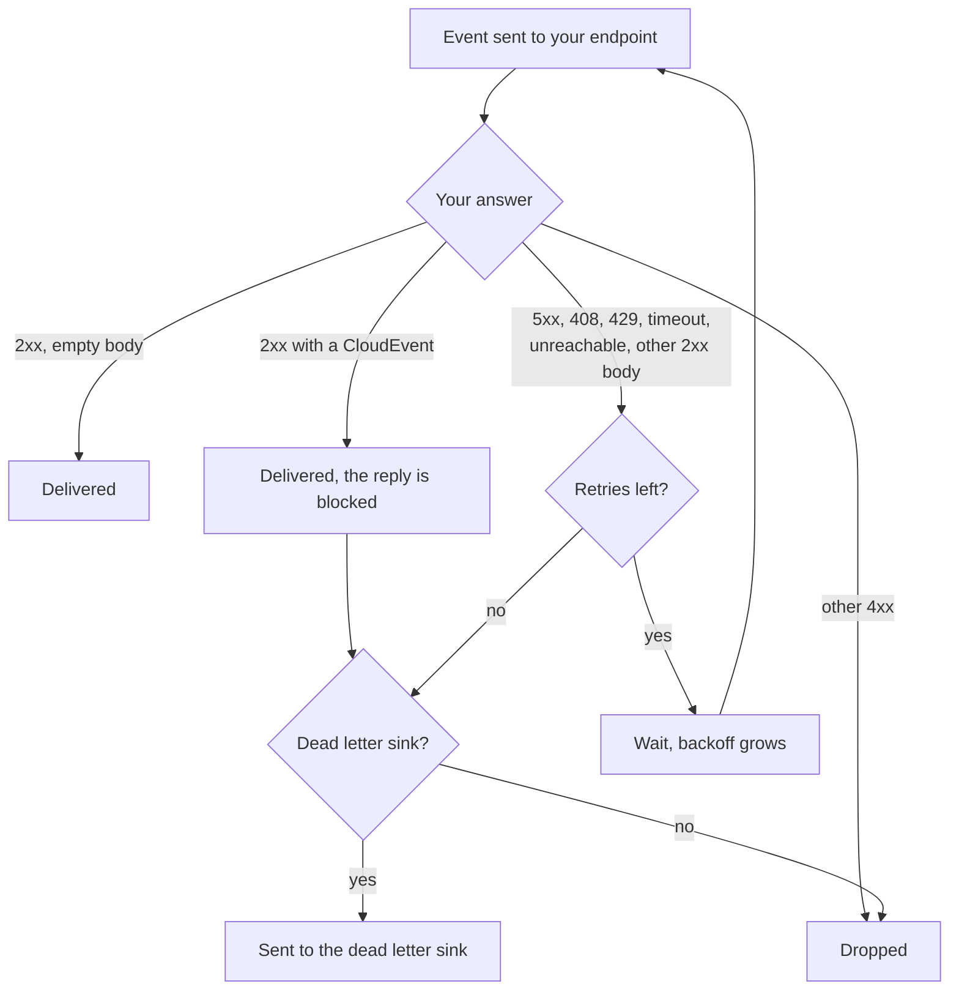

# Receiving events

This is for platform admins who want the membership and login events of the platform
delivered to their own HTTP endpoint.

## 1. Provide an endpoint

Your endpoint receives one CloudEvent per `POST`, in CloudEvents HTTP binary
mode: the attributes come as `ce-*` headers (`ce-id`, `ce-type`, `ce-source`,
`ce-subject`, `ce-time`, `ce-pmorg`), the data as the JSON body.
[api/openapi/subscriber.yaml](../api/openapi/subscriber.yaml) describes the
requests and the answers your endpoint must give; [contract.md](contract.md)
explains the fields.

The rules that matter:

- Answer with a 2xx and an **empty body**, quickly. A body that is not a
  CloudEvent counts as a failed delivery. A body that is a CloudEvent is taken
  as a reply. Replies are blocked and never reach anyone, but Knative counts
  the blocked reply as a failure: with a dead letter sink, every event you
  replied to also goes there, about a minute later, with `knativeerrordest`
  set to the broker.
- 5xx, 408 and 429 are retried with backoff; any other status is not (see
  below).
- The same event can arrive more than once. Drop events whose `ce-id` you have
  already seen. There is no order between events.
- The endpoint must be reachable from inside the cluster, for example as a
  Kubernetes Service. Requests come without credentials.
- Its host must be on the platform operator's allowlist (the controller's
  `--allowed-sink-hosts`: host names, or `*.suffix` for everything below a
  domain). Events carry user ids, so the operator decides where they may go.
  Otherwise the Subscription stays `Ready=False` with reason `SinkNotAllowed`.
  The same goes for the dead letter sink. The local install allows
  `*.eventing-demo-sink.svc.cluster.local`. Redirects are followed, so don't
  answer with one unless you mean to pass the events on.

## 2. Create a Subscription

Subscriptions live in the workspace `root:providers:eventing`, which only
platform admins can reach. With the repo's scripts on a local setup:

```sh
source hack/lib.sh
kcp root:providers:eventing apply -f - <<EOF
apiVersion: eventing.platform-mesh.io/v1alpha1
kind: Subscription
metadata:
  name: my-consumer
spec:
  filter:
    types:
      - io.platform-mesh.iam.membership.granted.v1alpha1
      - io.platform-mesh.iam.membership.revoked.v1alpha1
      - io.platform-mesh.iam.account.members.v1alpha1
      - io.platform-mesh.iam.user.loggedin.v1alpha1
    orgs: [acme]   # optional; without it you get all orgs
  sink:
    uri: http://my-consumer.my-namespace.svc.cluster.local
  delivery:
    retry: 3
    timeout: PT10S   # optional, per request
    deadLetterSink:  # optional
      uri: http://my-dead-letters.my-namespace.svc.cluster.local
EOF
kcp root:providers:eventing get subscriptions
```

`delivery` is optional; without it you get 10 retries with exponential
backoff from 0.2 seconds. `retry` is the number of retries after the first
failed attempt; `backoffPolicy` (`linear` or `exponential`, default
`exponential`) and `backoffDelay` (ISO 8601, default `PT0.2S`) shape the wait in
between. `timeout` limits a single request and must be more than zero; if Knative rejects
the settings, the Subscription stays `Ready=False` with reason `InvalidDelivery`. An event that still failed after the
last retry goes to `deadLetterSink`, with Knative's `knativeerrordest`,
`knativeerrorcode` and `knativeerrordata` attributes added; when the last try
timed out there was no answer, and these attributes are missing. Without a dead
letter sink it is dropped.

Only answers 5xx, 408 and 429, a sink that cannot be reached and a request
that times out are retried. Without `timeout` a request may take about 30
seconds. Any other 4xx drops the event at once, without the dead letter sink.



The Subscription is ready when `READY` is `True`; otherwise `REASON` says what
is missing. Events start arriving with the next change or login. Deleting the
Subscription stops delivery.

## Limits

- Events are kept for a day at most. A sink that is down longer misses them.
- Two Subscriptions with the same sink deliver each event twice, with the same
  `id`.
